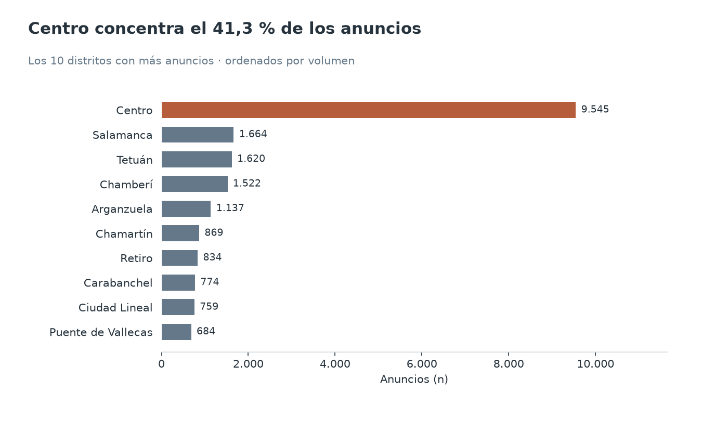
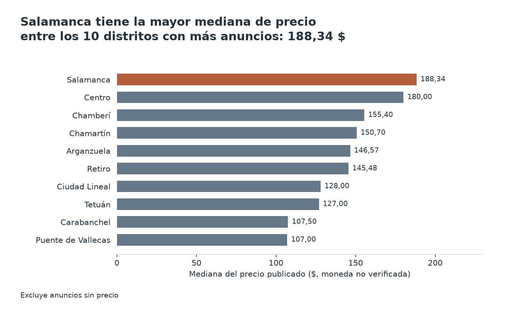
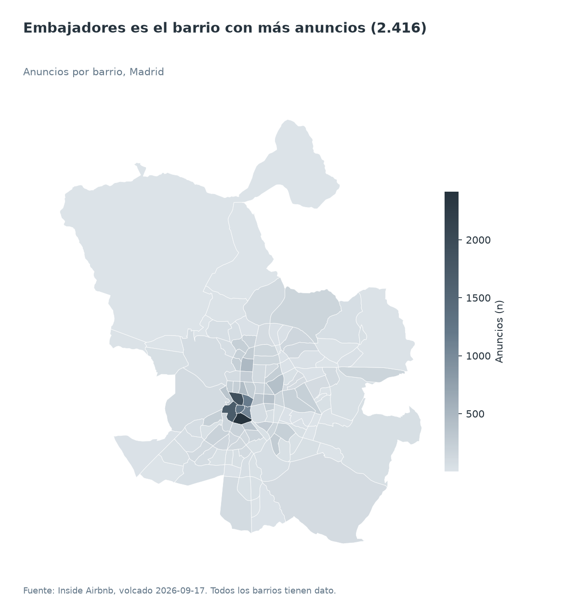
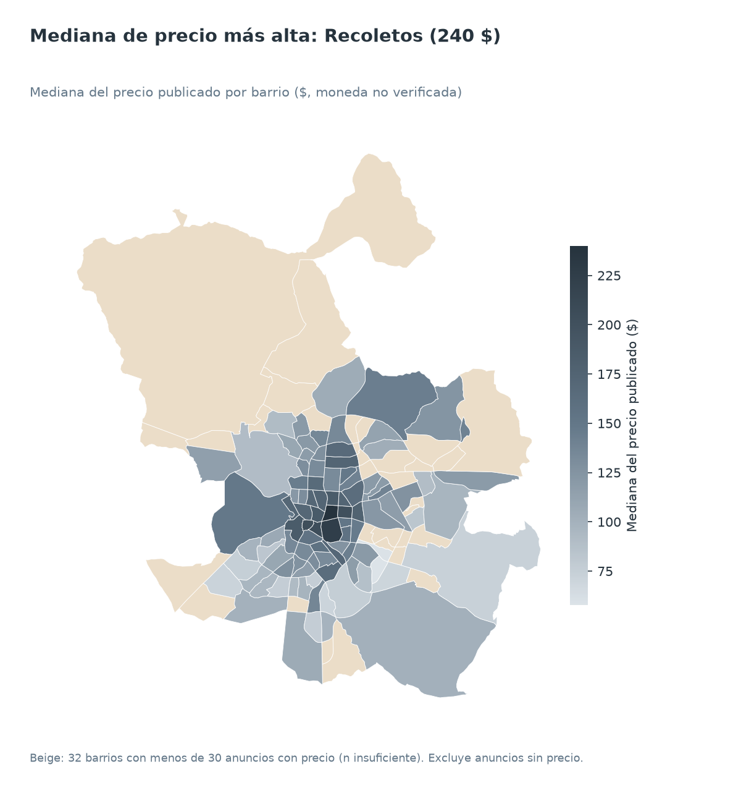
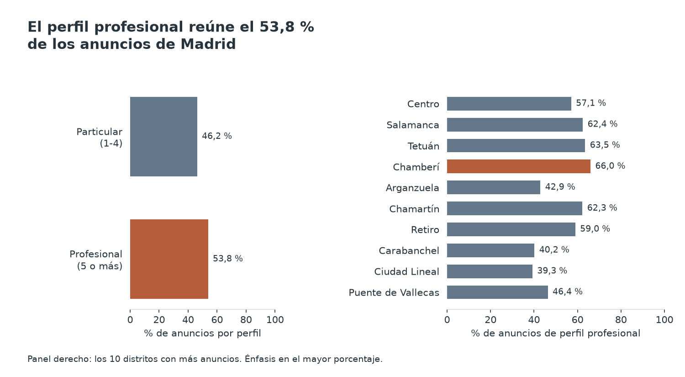
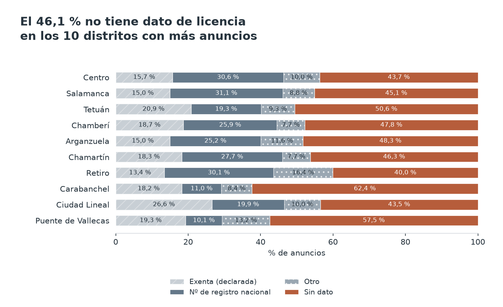
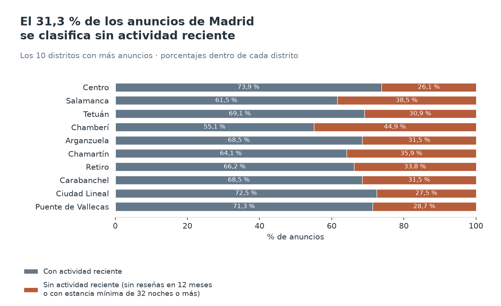
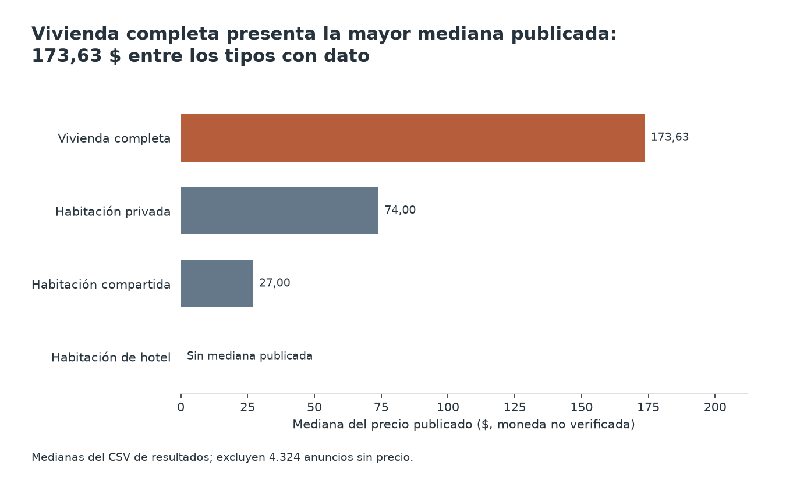
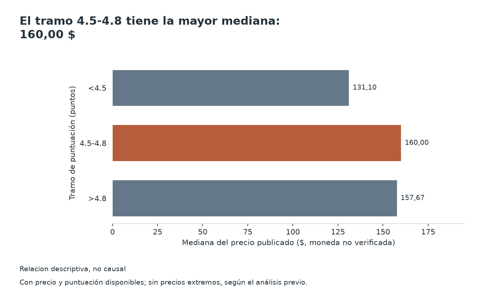

# Alquiler turístico en Madrid: análisis de Inside Airbnb (volcado 2026-09-17)

Proyecto de portfolio de análisis de datos. Es un análisis **descriptivo** de 23.109 anuncios públicos de Inside Airbnb. No establece causas.

## Fuente y licencia

- **Fuente:** [Inside Airbnb](https://insideairbnb.com/get-the-data/), volcado de Madrid del 2026-09-17. Inside Airbnb es un proyecto independiente y no está afiliado a Airbnb.
- **Licencia de los datos:** [Creative Commons Attribution 4.0 International (CC BY 4.0)](https://creativecommons.org/licenses/by/4.0/), según figura en su página de descarga de datos (consultada el 2026-10-18). Su uso exige atribución.
- **Alcance:** este análisis es independiente, hecho con fines formativos, y no es un producto de Inside Airbnb. Las cifras son resultado de mi procesado y pueden diferir de lo que publique la fuente.
- Los datos crudos no se incluyen en este repositorio. Se pueden descargar desde el enlace de la fuente.

## Preguntas

1. ¿Qué distritos y barrios concentran más anuncios y cuánto cuestan (mediana)?
2. ¿Cuánto del mercado es profesional frente a particular?
3. ¿Qué parte tiene licencia, es exenta o no da información, y cómo varía por distrito?
4. ¿Cuántos anuncios parecen realmente activos y cuántos están sin actividad reciente?
5. ¿Qué relación hay entre precio, tipo de alojamiento y puntuación?

## Método

| Paso | Script | Salida |
|---|---|---|
| Limpieza | `codigo/01_limpieza.py` | `datos/limpios/anuncios.csv` |
| Cifras y tablas | `codigo/02_analisis.py` | `resultados/*.csv` |
| Gráficos y mapas | `codigo/03_graficos.py` | `graficos/*.png` |

Todas las cifras de este documento salen de esos scripts. Para reproducirlo, ejecútalos en ese orden. Los datos crudos no se incluyen en el repositorio (`datos/crudos/` está en `.gitignore`).

Decisiones de método:

- **Mediana, no media.** Hay anuncios con precios muy altos (164 con precio superior a 1.000) que desplazan la media y apenas mueven la mediana.
- **Recuentos con todos los anuncios.** Los 164 anuncios de precio extremo **cuentan** en los recuentos, porque son anuncios reales. Solo se **excluyen de los gráficos de distribución de precio** y de la correlación entre precio y puntuación.
- **Anuncios sin precio.** 4.324 anuncios (18,7 %) no tienen precio. Se excluyen solo de las medianas de precio y se declara en cada gráfico.
- **Tamaño mínimo.** Las medianas se calculan solo con 30 o más anuncios con precio. Con menos, la tabla muestra "n insuficiente" (celda vacía en los CSV y beige en el mapa). Esto afecta a 32 de los 128 barrios.
- **Profesional.** Anfitrión con 5 o más anuncios. Es una **convención propia** de este proyecto, no una definición legal ni oficial.
- **Sin actividad reciente.** Anuncio sin reseñas en los últimos 12 meses **o** con estancia mínima de 32 noches o más.

## Hallazgos

Los precios son el "precio publicado" que aparece en el volcado, con símbolo "$". **No se ha podido verificar la moneda**, así que no se afirma que sean euros.

### 1. Dónde se concentran los anuncios y cuánto cuestan

- **Centro** tiene 9.545 anuncios, el 41,3 % del total, con una mediana de 180 $.
- Los cinco distritos con más anuncios suman el 67,0 %: Centro, Salamanca (1.664), Tetuán (1.620), Chamberí (1.522) y Arganzuela (1.137).
- Medianas de esos distritos: Salamanca 188,34 $, Tetuán 127 $, Chamberí 155,40 $ y Arganzuela 146,57 $. Carabanchel (107,50 $) y Puente de Vallecas (107 $) están entre los más baratos de los diez mayores.
- Por barrio, **Embajadores** (2.416 anuncios, 10,5 %), Universidad (1.916) y Palacio (1.701) encabezan la lista. Todos están en Centro.
- Entre los barrios con 30 o más precios, la mediana más alta es **Recoletos** (240 $) y la más baja **Portazgo** (57,71 $, con solo 33 anuncios con precio).

### 2. Mercado profesional frente a particular

- Los anfitriones con 5 o más anuncios son **782** y concentran **12.426 anuncios (53,8 %)**. Los 7.922 anfitriones con 1 a 4 anuncios tienen 10.683 anuncios (46,2 %).
- Mediana de precio: 159 $ para profesionales y 140 $ para particulares.
- El porcentaje de anuncios de profesionales va del 14,5 % en Vicálvaro (62 anuncios) al 66,0 % en Chamberí (1.522 anuncios).

### 3. Licencia

Categorías tal como vienen en los datos:

| Categoría | Anuncios | % |
|---|---|---|
| Sin dato | 10.913 | 47,2 |
| Nº de registro nacional | 5.790 | 25,1 |
| Exenta (declarada) | 4.057 | 17,6 |
| Otro | 2.349 | 10,2 |

- El porcentaje "Sin dato" va del 40,1 % en Retiro al 62,4 % en Carabanchel (entre los 21 distritos).
- La tabla completa por distrito está en `resultados/p3_licencia_distritos.csv`.

### 4. Actividad reciente

- **15.870 anuncios (68,7 %) tienen actividad reciente** y **7.239 (31,3 %) no la tienen**: sin reseñas en 12 meses o con estancia mínima de 32 noches o más.
- Componentes: 6.994 anuncios sin reseñas en 12 meses, 635 con estancia larga y 390 con ambas condiciones (6.994 + 635 − 390 = 7.239).
- Por distrito, el porcentaje sin actividad reciente va del 26,1 % en Centro al 57,9 % en Moratalaz (145 anuncios).

### 5. Precio, tipo de alojamiento y puntuación

- **Tipo.** Mediana de 173,63 $ en vivienda completa (16.182 anuncios), 74 $ en habitación privada (6.735) y 27 $ en habitación compartida (153). La habitación de hotel (39 anuncios) no llega a 30 precios y no tiene mediana.
- **Puntuación.** Solo 19.294 anuncios tienen puntuación. Las medianas por tipo están en `resultados/p5_tipo.csv`.
- **Relación precio y puntuación.** La correlación de Spearman es **0,08** (n = 16.081, sin precios extremos). Es muy débil: 0,12 en vivienda completa, 0,06 en habitación privada y 0,23 en habitación compartida (solo 123 anuncios).
- Mediana de precio por tramo de puntuación: 131,10 $ (menos de 4,5), 160 $ (de 4,5 a 4,8) y 157,67 $ (más de 4,8).

## Límites de los datos

- **Moneda no verificada.** El símbolo es "$" y no se ha podido comprobar la moneda. Las cifras de precio son las publicadas, sin conversión.
- **Precio publicado, no pagado.** Es el precio del anuncio en el momento del volcado. No refleja el precio final ni las reservas reales. Faltan precios en el 18,7 % de los anuncios, y esos anuncios pueden diferir de los demás.
- **Las reseñas son solo un indicio de actividad.** Que un anuncio no tenga reseñas en 12 meses no demuestra que esté inactivo. Puede tener reservas sin reseñas, haber sido nuevo o estar pausado. Por eso se habla de "sin actividad reciente" y no se afirma nada más.
- **Licencia.** Las categorías son las del volcado. No se sabe qué incluye "Otro", y "Sin dato" significa que no hay información, no que el anuncio sea irregular. No se compara con la normativa, porque no se ha podido verificar con estos datos.
- **Profesional.** El umbral de 5 anuncios es una convención de este proyecto. El recuento de anuncios por anfitrión es el que trae el volcado.
- **Una sola fecha.** El volcado es del 2026-09-17: no permite ver evolución ni estacionalidad.
- **Barrios pequeños.** Con pocos anuncios, los porcentajes y medianas son poco estables (por ejemplo, Vicálvaro tiene 62 anuncios). Varias columnas del volcado están vacías al 100 % y no se usan.
- **Sin causalidad.** Todo es descriptivo. Una correlación débil entre precio y puntuación no dice que una cause la otra, y las diferencias entre distritos no explican sus causas.

## Conclusiones

1. La oferta está muy concentrada: Centro reúne el 41,3 % de los anuncios y los cinco primeros distritos, el 67,0 %.
2. Más de la mitad de los anuncios (53,8 %) pertenecen a anfitriones con 5 o más anuncios, aunque estos son solo 782 anfitriones.
3. Casi la mitad de los anuncios (47,2 %) no aporta información de licencia, y esa proporción varía mucho entre distritos.
4. Cerca de un tercio (31,3 %) no muestra actividad reciente, aunque con las reseñas como único indicio esta cifra es orientativa.
5. El tipo de alojamiento marca diferencias de precio mucho mayores que la puntuación, cuya relación con el precio es muy débil (Spearman 0,08).

Pendiente de verificar: la moneda de los precios y el significado de la categoría de licencia "Otro".

## Extra: dashboard en Power BI

La carpeta `dashboard/` contiene los datos preparados (`codigo/04_dashboard.py`) y una guía paso a paso (`dashboard/GUIA_POWERBI.md`). Además hay un tablero interactivo en HTML autocontenido (`dashboard/dashboard.html`, generado con `codigo/05_dashboard_html.py`; sus cifras se calculan en el navegador y se contrastaron con pandas). El dashboard de **Power BI no está construido ni verificado**: la guía lo indica en cada punto que no se ha podido comprobar.
